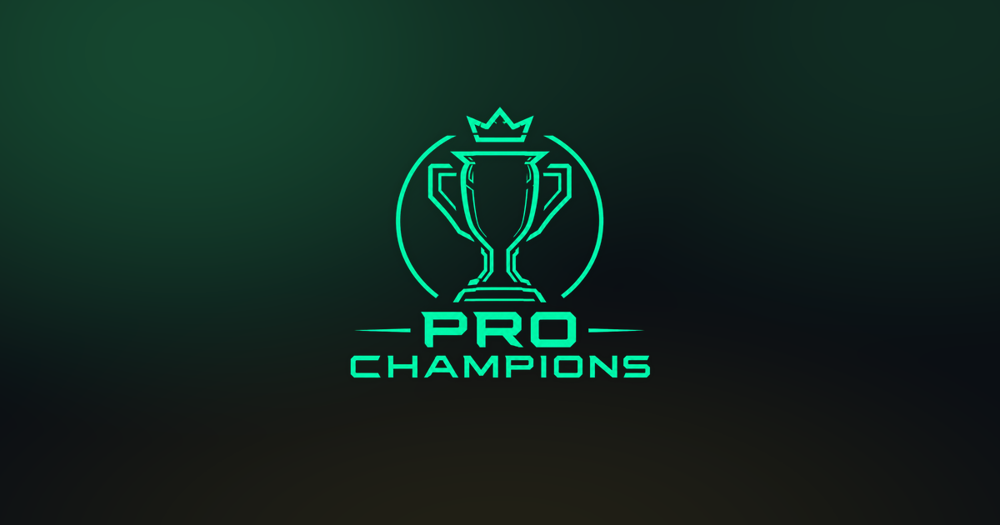

<p align="center">
  
</p>

# Pro Champions

Plataforma brasileira para organizar **campeonatos de EA FC Pro Clubs**: federações criam os
campeonatos, times se inscrevem, o chaveamento é sorteado, o placar é confirmado pelo próprio
site e o prêmio cai por Pix.

🔗 **Site no ar:** <https://www.prochampions.com.br>

---

## Como um campeonato funciona

1. Uma **federação** cria o campeonato: data, jogo (FC 26 ou FC 27), número de vagas, valor da
   inscrição e prêmios.
2. Os **times** se inscrevem — pagando o Pix na hora ou **reservando a vaga** e pagando antes de
   começar.
3. A organização **sorteia o chaveamento** (mata-mata, com ida e volta opcional, ou fase de
   grupos seguida de mata-mata).
4. Na hora do jogo, os **dois capitães confirmam "pronto"** e a partida começa a contar.
5. O **placar é confirmado**:
   - **FC 26** — cada capitão manda o print da tela final e uma IA lê e compara os dois;
   - **FC 27** — o site busca a partida direto na EA, sem print (e volta sozinho para o print
     se a EA estiver fora do ar).
6. A chave avança sozinha. Ao final, o **prêmio é pago por Pix** ao campeão, vice e 3º lugar, e
   ranking, XP e medalhas são atualizados.

## O que tem na plataforma

**Campeonatos**
- Mata-mata (opcionalmente ida e volta), fase de grupos e disputa de 3º lugar
- Inscrição direta ou reserva de vaga, reembolso por Pix quando o time é removido, edição do
  campeonato com confirmação por senha
- W.O. liberado 30 minutos depois do início da partida (declarado pela organização), chat entre
  os capitães e contestação de placar
- Pagamento de prêmio e repasse para a federação via Pix

**Times e jogadores**
- Times com escudo, código de convite, braçadeira de capitão e grupo de WhatsApp
- Formação tática com escalação por posição, recrutamento e pedidos de entrada
- Perfil com foto, posição preferida, chave Pix, nível/XP e medalhas — com perfil público
- Diretório de times e página de cada time

**Ranking e conquistas**
- Ranking por **temporada** (campeão 3 · vice 2 · 3º lugar 1), com histórico
- XP e nível de carreira por jogador e por time
- Medalhas por federação, por temporada e comemorativas

**Plataforma**
- Notificações dentro do site e **push no navegador** (instalável como app/PWA)
- Layout pensado para celular, com barra de navegação fixa
- Painel de administração do site (organizadores, federações, temporadas, ranking, medalhas)
- Modo manutenção para trocar o banco de lugar sem perder dados

## Tecnologias

| Camada | O que usa |
|---|---|
| Backend | Python, **Flask 3**, Flask-SQLAlchemy, Flask-Login, Flask-WTF (CSRF), Flask-Limiter |
| Banco | **PostgreSQL** (Supabase) em produção · **SQLite** localmente |
| Front-end | Templates Jinja2, CSS e JavaScript puros, sem etapa de build (Three.js só no troféu 3D do ranking) |
| Pagamentos | [AbacatePay](https://www.abacatepay.com) (Pix) |
| Leitura de prints | API da Anthropic (Claude) |
| Placar automático | API (não oficial) de Pro Clubs da EA |
| E-mail | [Resend](https://resend.com) |
| Push | Web Push com chaves VAPID (`pywebpush`) |
| Hospedagem | [Railway](https://railway.com) (`gunicorn`) |

## Rodando localmente

Precisa de **Python 3.13 ou superior** (a produção roda na 3.13).

```bash
git clone https://github.com/Celoabramo/pro-champions.git
cd pro-champions

python -m venv .venv
.venv\Scripts\activate          # Windows
# source .venv/bin/activate     # Linux / macOS

pip install -r requirements.txt

copy .env.example .env          # Windows  (cp .env.example .env no Linux / macOS)
# abra o .env e preencha — pra rodar local, FLASK_DEBUG=1 já basta

python app.py
```

Abra <http://localhost:5000>. Sem `DATABASE_URL`, o site usa um SQLite em `instance/` — as
tabelas e colunas novas são criadas/atualizadas sozinhas na inicialização.

**Virando organizador:** cadastre uma conta pelo site e rode

```bash
flask --app app promover-organizador voce@email.com
```

O acesso ao painel de administração do site é do e-mail definido na constante `ADMIN_EMAIL`
em `app.py` — troque pelo seu se for rodar a sua própria cópia.

### Variáveis de ambiente

Nenhuma é obrigatória para só abrir o site localmente; cada uma liga uma parte da plataforma.
**Nunca commite o `.env`** — ele já está no `.gitignore`.

| Variável | Para que serve |
|---|---|
| `SECRET_KEY` | Assina sessões e formulários. **Obrigatória em produção.** |
| `DATABASE_URL` | Postgres de produção. Sem ela, usa SQLite local. |
| `FLASK_DEBUG` | `1` em desenvolvimento (libera cookies sem HTTPS). |
| `ABACATEPAY_API_KEY` | Gera as cobranças Pix. |
| `ABACATEPAY_WEBHOOK_SECRET` | Confirmação automática de pagamento (opcional). |
| `ABACATEPAY_MODO_TESTE` | `1` mostra o botão de simular pagamento (chave de sandbox). |
| `ANTHROPIC_API_KEY` | Leitura dos prints de placar (FC 26). |
| `RESEND_API_KEY` · `EMAIL_REMETENTE` | E-mails: redefinição de senha e contestação. |
| `VAPID_PUBLIC_KEY` · `VAPID_PRIVATE_KEY` | Notificações push no navegador. |
| `URL_BASE_SITE` | Endereço do site, para montar links em tarefas de fundo. |
| `PASTA_UPLOADS` | Onde ficam fotos, escudos e prints (em produção, um volume persistente). |
| `MANUTENCAO` | `1` troca o site inteiro por uma tela de "já voltamos". |

## Estrutura do projeto

```
app.py                 rotas, regras de negócio e inicialização
models.py              tabelas (SQLAlchemy)
pagamentos.py          integração com o Pix (AbacatePay)
validacao_ia.py        leitura do placar a partir dos prints
ea_client.py           cliente da API de Pro Clubs da EA
notificacoes_push.py   notificações push (Web Push / VAPID)
email_util.py          envio de e-mail
migrar_banco.py        cópia pontual entre dois bancos Postgres (apaga o destino!)
templates/             páginas (Jinja2)
static/                CSS, imagens, service worker e manifest do PWA
ROADMAP.md · PLANO_*.md   histórico de decisões e planos de cada funcionalidade
```

## Deploy

O deploy é automático no **Railway** a cada push na `master`, usando o `Procfile`:

```
web: gunicorn app:app --bind 0.0.0.0:$PORT --workers 1 --threads 8 --timeout 60
```

Alguns cuidados que valem para quem for mexer:

- **`--workers 1` é de propósito.** Os contadores do limitador de requisições e o cache e a
  pausa da API da EA vivem na memória do processo, e as varreduras de fundo rodam como threads
  dentro dele. Com mais de um worker, cada um teria o seu — antes de escalar, esse estado
  precisa ir para o banco e as varreduras precisam rodar em um lugar só.
- **Migrações só adicionam.** Colunas novas entram por `_garantir_colunas_novas()` em
  `app.py`; nenhuma migração apaga coluna ou tabela existente.
- **Versões travadas.** O `requirements.txt` fixa o `SQLAlchemy` abaixo da 2.1 e o driver do
  Postgres é forçado para `psycopg2` — um `pip install` sem isso já derrubou o site uma vez.
- **A API da EA não é oficial.** Ela pode mudar ou bloquear sem aviso, por isso o envio de
  print continua existindo como alternativa permanente.

## Documentação interna

- [`ROADMAP.md`](ROADMAP.md) — visão geral das funcionalidades e a ordem em que foram feitas
- [`PLANO_TEMPORADA_RANKING.md`](PLANO_TEMPORADA_RANKING.md) — temporadas e ranking
- [`PLANO_XP_NIVEL.md`](PLANO_XP_NIVEL.md) — XP e nível
- [`PLANO_ESCALACAO_POSICOES.md`](PLANO_ESCALACAO_POSICOES.md) — escalação e posições

## Licença

© 2026 Pro Champions. Todos os direitos reservados.
